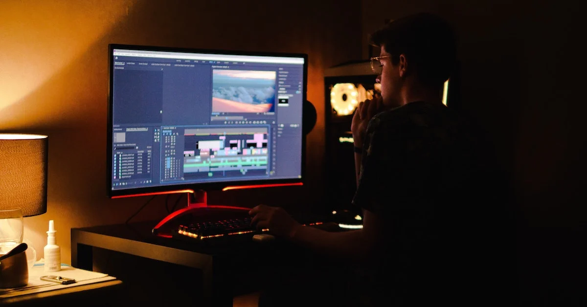

# LAXTLINE — Portfolio Website

A one-page portfolio site for a video editor and visual storyteller. It shows video edits,
photo work and design projects in an animated gallery, and the owner can add or remove media
from a hidden admin panel without touching the code.

I built this as my personal portfolio project while learning front-end development. There is
no framework and no backend — just HTML, CSS and plain JavaScript — so it is easy to read, easy
to run and cheap to host.

**Live links**

- Cloudflare Workers (main): <https://laxtline.suryakant321pradhan.workers.dev/>
- GitHub Pages (backup): <https://laxtline.github.io/laxt-line-studio3/>

---

## Table of contents

1. [Tech stack](#tech-stack)
2. [Key features](#key-features)
3. [Folder structure](#folder-structure)
4. [What each file does](#what-each-file-does)
5. [How the gallery works](#how-the-gallery-works)
6. [Setup and run](#setup-and-run)
7. [Admin panel and demo login](#admin-panel-and-demo-login)
8. [Screenshots](#screenshots)
9. [Deployment](#deployment)
10. [What I learned](#what-i-learned)
11. [Known limitations](#known-limitations)
12. [Contact](#contact)

---

## Tech stack

| Area | What I used | Why |
|------|-------------|-----|
| Markup | HTML5 | One page, clear section structure |
| Styling | CSS3 (custom properties, grid, flexbox, multi-column masonry, keyframes) | No CSS framework needed for a single page |
| Logic | Vanilla JavaScript (ES6+) | Wanted to understand the DOM instead of hiding behind a library |
| Media storage | ImageKit.io | Free media CDN, image resizing with URL parameters, video thumbnails |
| Fonts | Google Fonts (Bebas Neue, DM Sans, Space Mono) | Free and matches the film-poster look |
| Hosting | Cloudflare Workers, GitHub Pages | Both free, both serve static files with HTTPS |

No build step, no `package.json`, no bundler. The folder you clone is the site you host.

---

## Key features

- **Animated hero section** — canvas particle background, red glow layers, scan lines and a huge
  brand watermark behind the text.
- **Custom cursor** — a small dot with a trailing ring. It is only created on desktop, because
  the blend mode darkens the screen on touch phones.
- **Project galleries built from data, not markup** — both gallery sections are empty `<div>`s in
  the HTML and are filled from a JSON manifest stored in ImageKit.
- **Hover-to-play videos (desktop) and muted autoplay (mobile)** — with a tap to unmute.
- **Fullscreen viewer** — play/pause, seek bar, volume, previous/next, keyboard shortcuts and
  arrow keys.
- **Lazy loading plus memory release** — a video only loads near the viewport and its buffer is
  freed once it is far off screen, so scrolling past 100 clips does not freeze the page.
- **Automatic image quality by connection** — slow connections get smaller images and lighter
  posters (`js/00-net-quality.js`).
- **Scroll-triggered entrance animations** — sections fade and slide in every time they enter the
  viewport. They respect `prefers-reduced-motion`.
- **Hidden admin panel** — upload, delete and reorder media from the browser; the live site
  updates on every device.
- **SEO ready** — meta description, Open Graph and Twitter cards, `sitemap.xml`, `robots.txt` and
  a PWA manifest so the site can be added to a phone home screen.
- **Responsive** — three gallery columns on desktop, two on tablet, one on mobile.

---

## Folder structure

```
Laxt-Line-Studio-Imagekit/
│
├── index.html                 Main page (open or host this file)
├── README.md                  This file
├── robots.txt                 Crawler rules + sitemap location
├── sitemap.xml                URLs for search engines
├── site.webmanifest           PWA name, colours and icon
├── .nojekyll                  Tells GitHub Pages to skip Jekyll
├── .gitignore                 Files that must not be pushed
│
├── assets/                    Page images (hero photo, about photo, logo, backgrounds)
├── css/
│   ├── main.css               Global styles: variables, nav, hero, sections, footer
│   ├── gallery.css            Gallery cards, hover overlays, fullscreen viewer
│   └── admin.css              Admin gear icon, login modal, upload panel
├── js/
│   ├── 00-net-quality.js      Picks image/poster sizes from the connection speed
│   ├── 01-cursor-init.js      Adds the custom cursor elements (desktop only)
│   ├── 02-interactions.js     Hero canvas, cursor movement, scroll reveal, mobile menu
│   ├── 04-gallery-video.js    Video playback, lazy load, memory release, fullscreen viewer
│   ├── 05-media-engine.js     Reads the ImageKit manifest and renders both galleries
│   └── 06-admin.js            Login modal and the media upload panel
│
└── Laxtline_Docs/             My own notes, guides and PDFs (not part of the website)
```

**Load order matters.** CSS is loaded `main.css` → `gallery.css` → `admin.css` so the later files
can override earlier rules. The JS files are numbered and loaded in order, because each one
expects the one before it (for example `02-interactions.js` looks for the cursor elements that
`01-cursor-init.js` created).

---

## What each file does

| File | Description |
|------|-------------|
| `index.html` | Head and SEO tags, the `window.LAXT_IK` config block, all page sections, empty gallery containers and the small inline animation scripts. Around 940 lines. |
| `css/main.css` | Brand colours in `:root`, navigation, hero, marquee, about, services, software, contact, footer and all the responsive breakpoints. Around 1,100 lines. |
| `css/gallery.css` | The multi-column gallery grid, card overlays, play and mute buttons, and every `.fsv-*` rule for the fullscreen viewer. Around 760 lines. |
| `css/admin.css` | The gear button, login dialog, upload panel, progress bars and toast messages. Around 200 lines. |
| `js/00-net-quality.js` | `window.LaxtNet` — reads `navigator.connection` and picks the image widths, poster width and preload amount. |
| `js/01-cursor-init.js` | Very small file. Creates the cursor dot and ring only when the device has a mouse. |
| `js/02-interactions.js` | Hero canvas animation, cursor follow logic, `IntersectionObserver` scroll reveal, nav state on scroll, hamburger menu. |
| `js/04-gallery-video.js` | The biggest file. Hover and touch playback, first-gesture unmute, lazy load, memory release, aspect ratio handling and the fullscreen viewer. |
| `js/05-media-engine.js` | Fetches `manifest.json` from ImageKit, builds the cards, caches the result in `localStorage`, and exposes `window.LaxtMedia` with `add`, `remove` and `reorder`. |
| `js/06-admin.js` | The gear icon, the login check, and the upload panel with two zones (Project Gallery and All Projects). |

The JS is about 3,000 lines in total and every file starts with a comment block that explains
what the file does and why it exists.

---

## How the gallery works

The HTML has no image or video tags for the gallery. Everything is rendered at runtime:

1. `js/05-media-engine.js` fetches a small `manifest.json` file from the ImageKit folder. That
   file stores the list of items, their order and a few details (width, height, type).
2. A card is created for each item using the public ImageKit URL. Images use `?tr=w-<width>` so
   the browser can download a smaller copy, and videos get a poster from `<url>/ik-thumbnail.jpg`.
3. The last known result is cached in `localStorage`, so the gallery paints immediately on the
   next visit and then quietly checks the manifest for changes.
4. `js/04-gallery-video.js` takes over the videos and handles loading, playing and freeing memory.

The two folders in ImageKit are:

| Section | ImageKit folder | Max items | Cache key |
|---------|-----------------|-----------|-----------|
| Project Gallery | `Laxt-Line-Studio/Project-Gallery` | 15 | `laxtline_gallery` |
| All Projects | `Laxt-Line-Studio/All-Project` | 100 | `laxtline_allprojects` |

To point the site at a different ImageKit account, change the `urlEndpoint`, `folders` and
`manifests` values inside `window.LAXT_IK` in `index.html`.

---

## Setup and run

You only need a browser and internet, because the media lives on ImageKit.

**Option 1 — open the file directly**

```
Double-click index.html
```

**Option 2 — a small local server (recommended)**

Some browsers block video autoplay and `crypto.subtle` on `file://`, so a local server is better:

```bash
# Python (already installed on most machines)
python -m http.server 8000

# or with Node.js
npx serve .
```

Then open <http://localhost:8000>.

**Testing the admin panel locally** use `http://localhost:8000`, not a `file://` path. The upload
signing uses the Web Crypto API, which the browser only allows on a secure origin (`https` or
`localhost`).

---

## Admin panel and demo login

The admin panel is opened with the small gear icon in the top-right corner of the page. After
login the Media Manager panel slides in with two zones and a live count on each one
(for example `9 / 15`).

**Demo credentials (placeholder values):**

```
Username: admin
Password: changeme123
```

> These are placeholder values for the README. The real demo credentials are stored as a base64
> string in `js/06-admin.js` (`CREDS_B64`). Because this is a static site there is no server to
> check a password, so the login only unlocks the admin screen — it is not real security.

What the panel can do:

- Upload images (JPG, PNG, WEBP) and videos (MP4) from the file picker or by drag and drop.
- Delete an item from the gallery.
- Reorder items by dragging, or with the ▲ / ▼ buttons.
- Show a progress bar while a large video uploads straight from the browser to ImageKit.

"Delete" removes the item from `manifest.json`, so it disappears from the site straight away.
The original file stays in ImageKit storage and can be removed from the ImageKit dashboard.

---

## Screenshots

The screenshots below are the actual images used on the page.

**Hero section**



**About section**


**Brand mark**


> The admin panel is private, so I have not included screenshots of it in the repository.

---

## Deployment

The site is deployed on two free platforms, so if one is down the other still works.

**1. Cloudflare Workers (main)**

- Live: <https://laxtline.suryakant321pradhan.workers.dev/>
- Static assets are served from Cloudflare's edge network with automatic HTTPS.

**2. GitHub Pages (backup)**

- Live: <https://laxtline.github.io/laxt-line-studio3/>
- Repo: [`laxtline/laxt-line-studio3`](https://github.com/laxtline/laxt-line-studio3)
- One-time setup: **Settings → Pages → Deploy from a branch → `main` → `/ (root)`**.
- The `.nojekyll` file stops GitHub from running Jekyll, so every file is served exactly as it is.

Pushing to `main` redeploys the GitHub Pages copy automatically:

```bash
git add .
git commit -m "update gallery and copy"
git push origin main
```

Vercel and Render also work with zero configuration because there is no build step — the output
directory is the repository root. Step-by-step instructions for every platform, plus a checklist
for the first deploy, are in **`Laxtline_Docs/deployment-steps.pdf`**.

**Things to update after moving to a new domain**

1. `sitemap.xml` — every `<loc>` URL.
2. `robots.txt` — the `Sitemap:` line.
3. `index.html` — the `canonical`, `og:url`, `og:image` and `twitter:image` tags.

The current canonical URL in `index.html` still points to `https://laxt-line-studio.vercel.app/`,
so it should be changed to the real domain.

---

## What I learned

- Spending time on load order and lazy loading is worth it. My first version became slow and
  janky after I scrolled past around 20 videos, and freeing the video buffer when it goes off
  screen fixed it.
- A static site can still feel dynamic. Reading a JSON manifest and rendering cards from it gave
  me the same result as a database-backed gallery, without any server.
- Small things like `prefers-reduced-motion`, `:focus-visible` and page speed are noticed. It is
  not only about how the site looks.
- I still had to read a lot of documentation for `IntersectionObserver`, the `<video>` API and the
  ImageKit upload signature. Most of the bugs I fixed came from not reading the docs properly the
  first time.

---

## Known limitations

- Media is fully dependent on ImageKit. If the account or the CDN is down, the galleries are
  empty (the rest of the page still works).
- The admin login is a client-side gate only. Real authentication would need a backend.
- The logo is a ~500 KB JPEG used as a favicon. It should be exported as a small PNG or ICO.
- There are no automated tests. I tested the site manually on Chrome, Firefox and an Android
  phone.

---

## Contact

- **Email:** suryakant321pradhan@gmail.com
- **Phone:** +91 78480 03467
- **Location:** Bhubaneswar, Odisha, India
- **Instagram:** [@surya.pradhan\_](https://www.instagram.com/surya.pradhan_/)
- **LinkedIn:** [Suryakanta Pradhan](https://www.linkedin.com/in/suryakanta-pradhan-b4179b27a/)

---

© 2025–2026 LAXTLINE Studio. All rights reserved.
